<br/>

<p align="center">
  <b>Victor Faria de Sousa</b> — Data Engineer since 2018 · GCP / BigQuery lakehouses, data quality and AI-assisted engineering · co-founder of <a href="https://github.com/Venturi-Tech">Venturi</a>
  <br/>
  Open to <b>Senior Data Engineer</b>, <b>Tech Lead</b> and <b>Data Architect</b> roles · remote · Brasília, Brazil · PT / EN
</p>

<p align="center">
  <picture>
    <source media="(prefers-color-scheme: dark)" srcset="./assets/ticker.svg"/>
    <source media="(prefers-color-scheme: light)" srcset="./assets/ticker-light.svg"/>
    
  </picture>
</p>

<br/>

<picture>
  <source media="(prefers-color-scheme: dark)" srcset="./assets/h01.svg"/>
  <source media="(prefers-color-scheme: light)" srcset="./assets/h01-light.svg"/>
  
</picture>

```sql
-- whoami
SELECT * FROM gold.engineers WHERE handle = 'vsousaventuri';

-- name      │ Victor Faria de Sousa
-- role      │ Data Engineer · Data Architect
-- since     │ 2018 — from corporate BI to cloud lakehouses, across 5 industries
-- clouds    │ GCP · Azure · Cloudera
-- focus     │ lakehouse design · data quality · observability · AI tooling
-- building  │ Venturi — drone imagery → building diagnostics
-- (1 row)
```

<picture>
  <source media="(prefers-color-scheme: dark)" srcset="./assets/h02.svg"/>
  <source media="(prefers-color-scheme: light)" srcset="./assets/h02-light.svg"/>
  
</picture>

<table>
  <tr>
    <td width="50%" valign="top">
      <h3>🏗️ Data platforms</h3>
      BigQuery lakehouse with bronze / silver / gold layers, Dataform, Cloud Storage and Looker on GCP.
    </td>
    <td width="50%" valign="top">
      <h3>🔁 Pipeline engineering</h3>
      Multi-client ingestion for retail data, incremental modeling (MERGE, partitioning, deduplication), data contracts and schema design.
    </td>
  </tr>
  <tr>
    <td width="50%" valign="top">
      <h3>🛡️ Reliability &amp; governance</h3>
      Data quality and freshness checks, observability and Architecture Decision Records (ADRs).
    </td>
    <td width="50%" valign="top">
      <h3>🤖 AI-assisted engineering</h3>
      Claude Code, custom Skills and MCP integrations to audit, document and test pipelines — plus roadmaps, code review and mentoring.
    </td>
  </tr>
</table>

<picture>
  <source media="(prefers-color-scheme: dark)" srcset="./assets/h03.svg"/>
  <source media="(prefers-color-scheme: light)" srcset="./assets/h03-light.svg"/>
  
</picture>

> **[Venturi](https://github.com/Venturi-Tech)** — co-founder.
> We turn aerial drone imagery into a technical pre-analysis of building pathologies for the construction sector.
> I take care of the data side: metadata extraction, image processing pipelines and the datasets behind the vision models.

<picture>
  <source media="(prefers-color-scheme: dark)" srcset="./assets/h04.svg"/>
  <source media="(prefers-color-scheme: light)" srcset="./assets/h04-light.svg"/>
  
</picture>

- 🗳️ Authorized investigator in the **Public Security Test of the Brazilian electronic voting system** (TSE, 2017–2021)
- 🔑 Background in cryptography and information security
- 🛸 Drone pilot and aerial photographer

<picture>
  <source media="(prefers-color-scheme: dark)" srcset="./assets/h05.svg"/>
  <source media="(prefers-color-scheme: light)" srcset="./assets/h05-light.svg"/>
  
</picture>

<div align="center">

**Languages & processing**<br/>


**Cloud & warehouse**<br/>


**Modeling, orchestration & BI**<br/>


**Engineering & AI**<br/>


</div>

<picture>
  <source media="(prefers-color-scheme: dark)" srcset="./assets/h06.svg"/>
  <source media="(prefers-color-scheme: light)" srcset="./assets/h06-light.svg"/>
  
</picture>

<div align="center">

[](https://www.linkedin.com/in/victor-fsousa/)
[](mailto:vsousa.venturi@gmail.com)
[](https://github.com/Venturi-Tech)

</div>

<br/>


